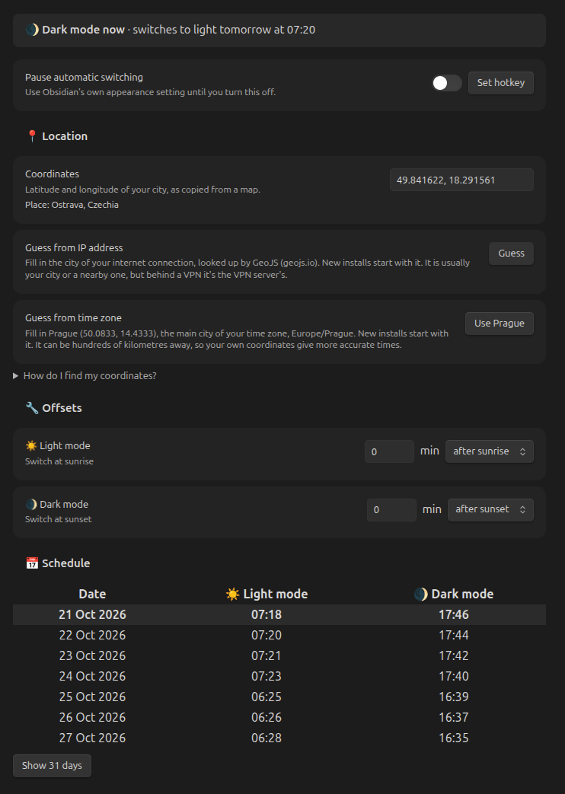

# Smart DayNight Switcher

Calculates daily sunrise and sunset times for your location and automatically switches your Obsidian theme: light mode when the sun rises ☀️ and dark mode when it sets 🌒.

No more manual theme switching!

## How does it work?

The plugin calculates sunrise and sunset for your location on your device and switches Obsidian to light mode at sunrise and dark mode at sunset. It finds your location by itself (from your IP address, or your time zone if that fails); for accurate times, you can enter your own coordinates in the settings.

---

### ❓ Can it switch a bit before or after sunrise/sunset?

Yes. Set a sunrise and/or sunset offset (up to 3 hours) in the settings, e.g. to turn on dark mode 10 minutes before sunset.

### ❓ Can I turn it off for a while?

Yes. Turn on “Pause automatic switching” in the settings, and Obsidian’s own light/dark setting applies until you turn it off. The “Pause or resume automatic switching” command does the same, and the “Set hotkey” button next to the toggle lets you give it a hotkey.

## 🐛💡 Found a bug or have a feature idea?

Feel free to open an issue in [this repository](https://github.com/Andrii256/ops_obsidian_smart-day-night-switcher/issues). I’ll check it out and do my best to help!

## Credits

Sunrise and sunset are calculated with [SunCalc](https://github.com/mourner/suncalc) by Vladimir Agafonkin, whose formulas are based on the [Astronomy Answers](https://aa.quae.nl/en/reken/zonpositie.html) articles on the position of the sun.
